# StackReel

**Reverse engineer any website — into an evidence-backed architecture map and a narrated MP4 explainer video.**

Paste a public URL. StackReel inspects what the site publicly reveals (headers, TLS, DNS, the rendered page and every network request, captured in a sandboxed browser), identifies technologies with deterministic signatures, and builds an architecture map in which **every component is labelled OBSERVED, INFERRED or UNKNOWN and linked to the evidence behind it**. It then writes a six-scene technical script from that map, narrates it, and renders a real, verified MP4 (H.264 video + AAC audio) with captions.


<p align="center">
  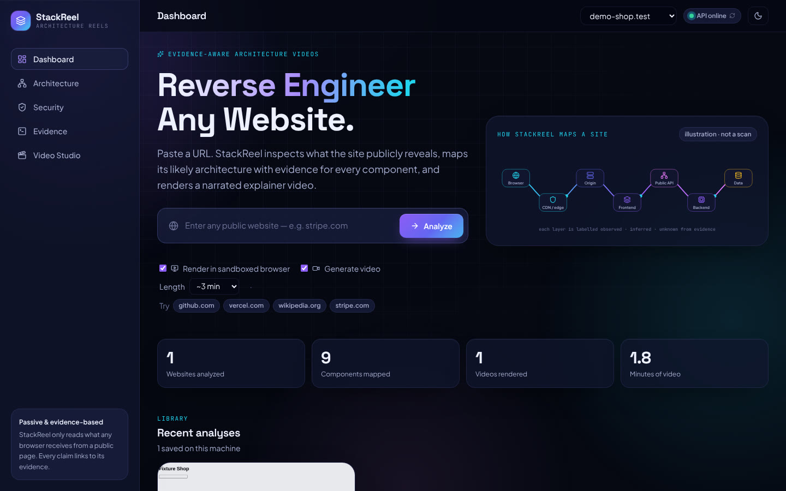
</p>

---
---

## Screenshots

> Captured from a real run against StackReel's local demo website (`demo-shop.test`, a test fixture that imitates a Next.js shop behind nginx with an Express API). Regenerate them any time with `npm run build && npm run screenshots`.

### Architecture explorer

Every box is a component found (or explicitly not found) on the site. Solid border = **observed**, dashed = **inferred**, dotted = **unknown**.

| Dark | Light |
|---|---|
| 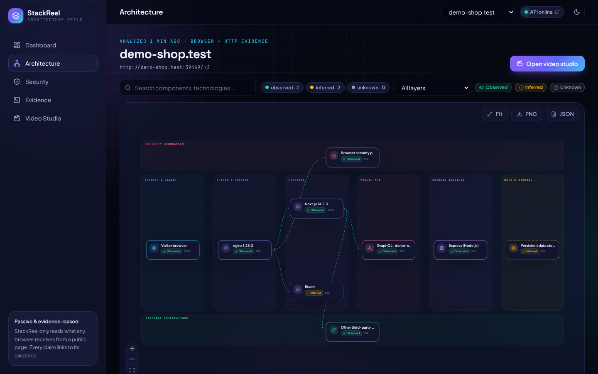 | 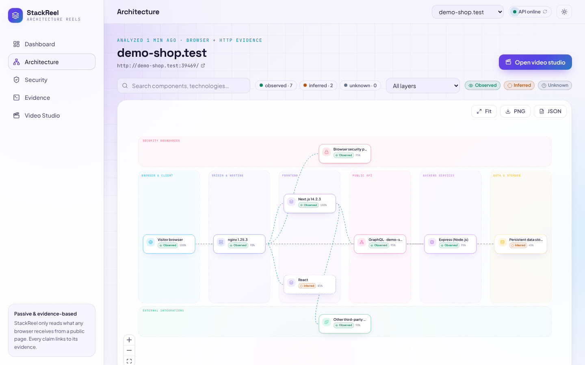 |

Click any component to see **why it exists** — the exact evidence, confidence, limitations and relationships:

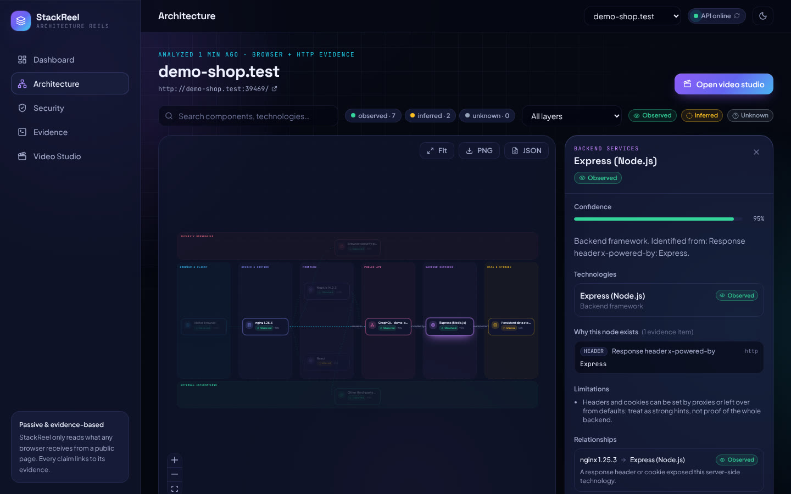

### Video studio

Plays the rendered MP4 with captions, a scene timeline with thumbnails and the real narration waveform. Shows the audio level measured inside the finished file.

| Dark | Light |
|---|---|
| 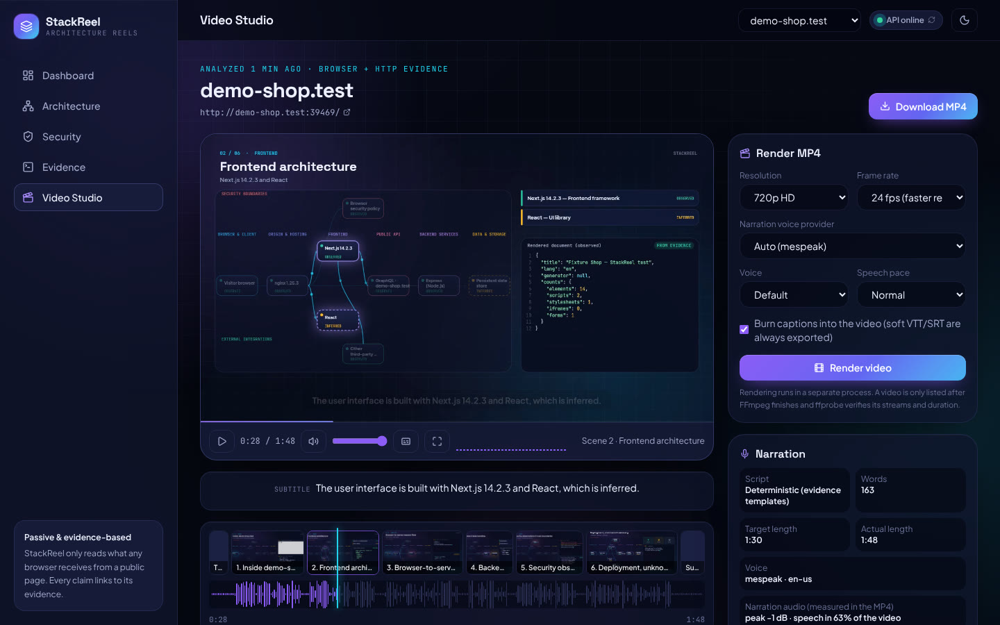 | 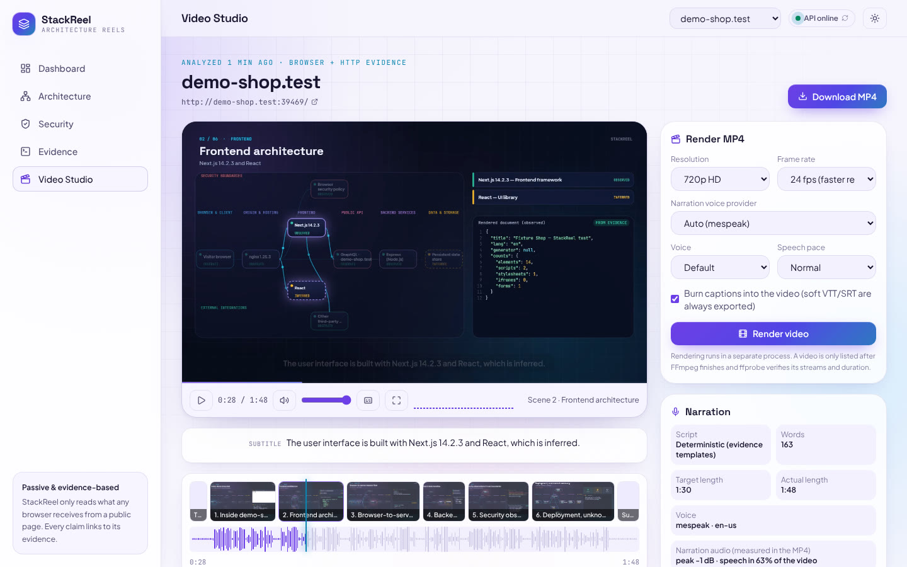 |

### Frames from a generated video

| Title sequence | Request-flow scene | Security scene |
|---|---|---|
| 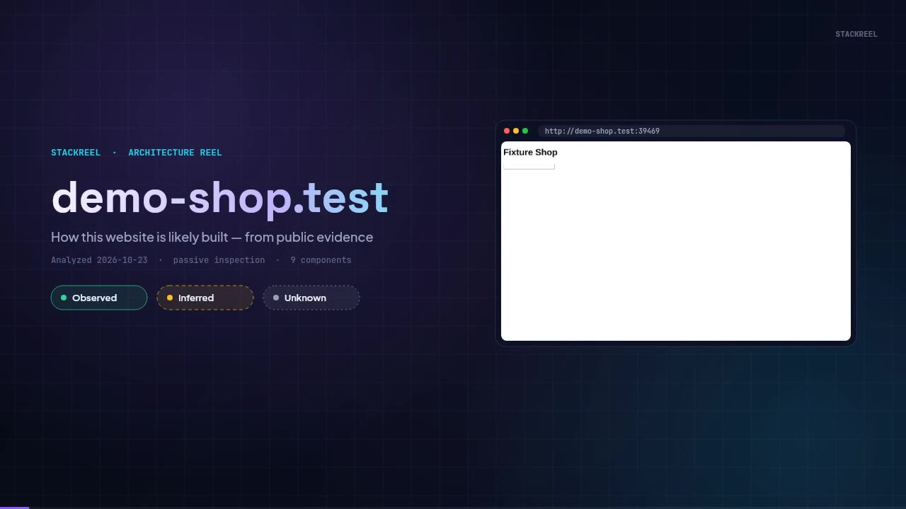 | 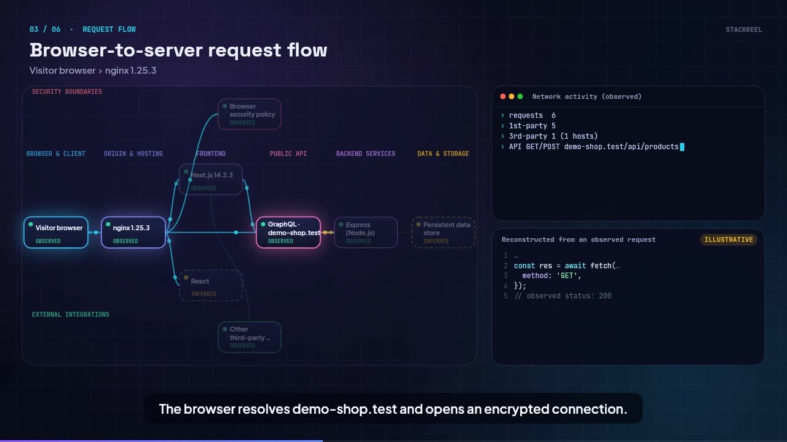 | 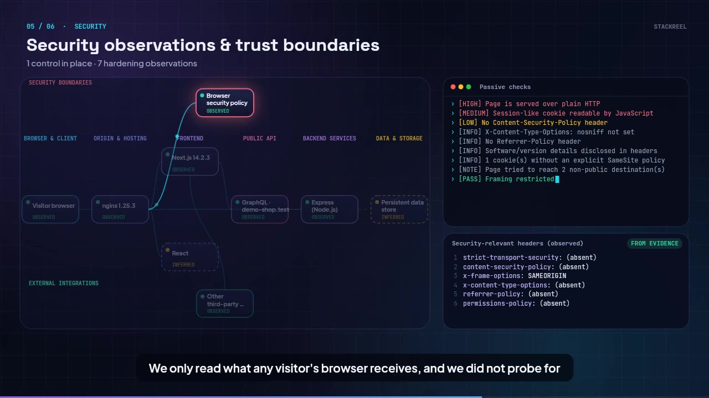 |

### Security, evidence, dashboard and mobile

| Passive security findings | Raw evidence |
|---|---|
| 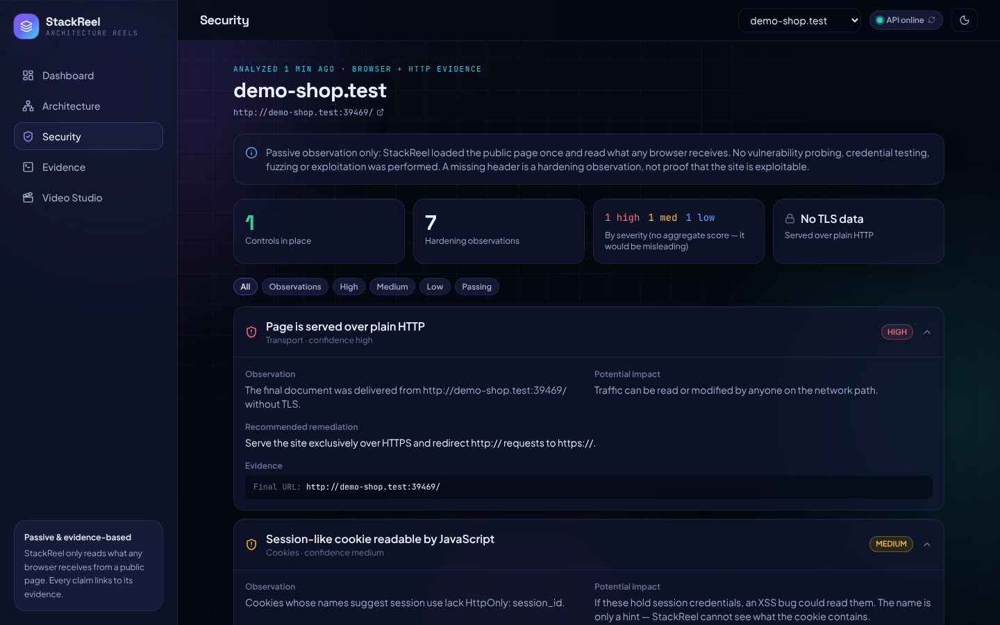 | 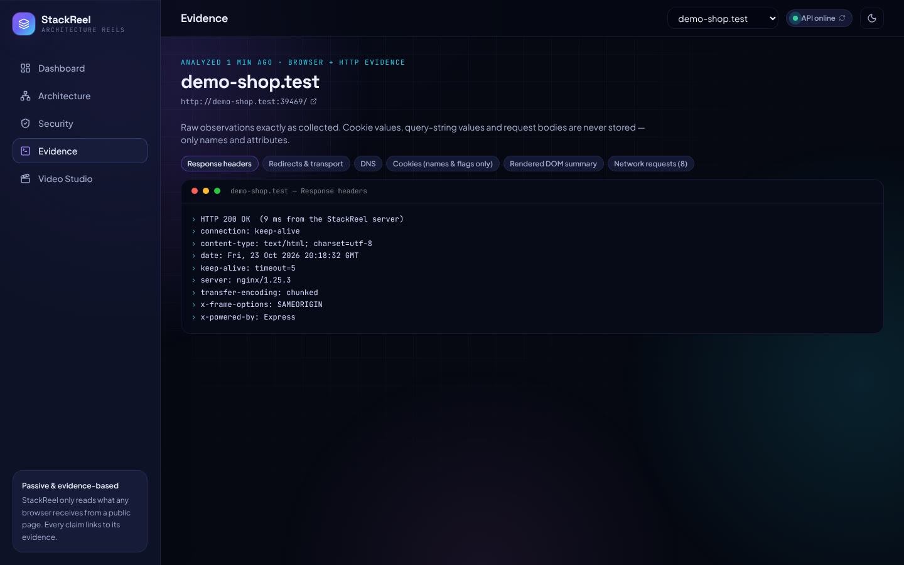 |

| Dashboard (light) | Mobile |
|---|---|
| 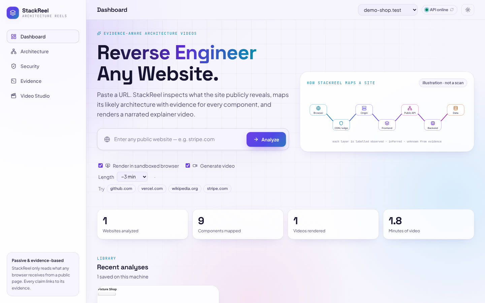 | 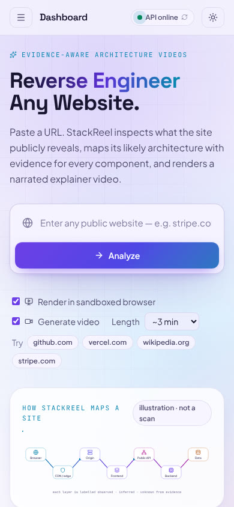 |

---

## Quick start (Windows)

Requirements: **Node.js 20.19+ (22 LTS recommended)** from <https://nodejs.org>. Nothing else — FFmpeg is installed automatically as a dependency.

**Easiest:** double-click `setup-windows.cmd` once, then `start-windows.cmd` whenever you want to use StackReel. Open **http://localhost:5173**.

Or in **PowerShell**, inside the project folder:

```powershell
npm run setup                  # 1. install everything + the headless Chromium (one time)
Copy-Item .env.example .env    # 2. optional: create your settings file
npm run doctor                 # 3. check every component (FFmpeg, browser, voices, ports)
npm run dev                    # 4. start the API + web app → http://localhost:5173
```

Stop with `Ctrl+C`. For a single-address production server: `npm run build` then `npm start` → http://127.0.0.1:5001.

---

## System architecture

### 1. Overview — what runs where

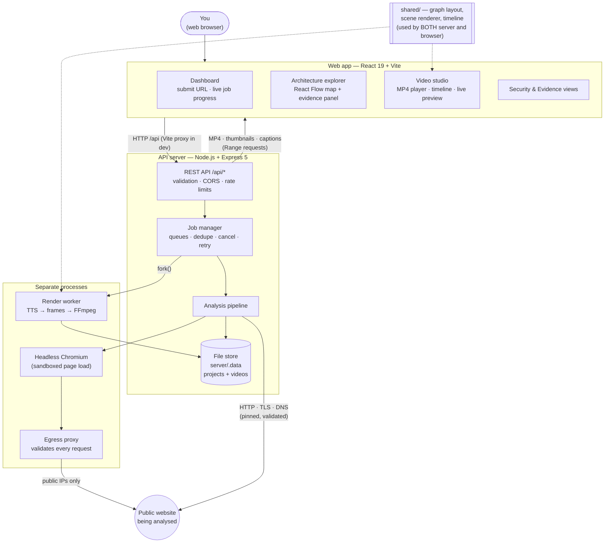

<sub>Diagram not showing? <a href="docs/diagrams/system-overview.png">View it as an image</a>.</sub>

- **Long work never blocks a request.** Starting an analysis or a render returns a job immediately; the web app polls `GET /api/jobs/:id` for real progress, logs and errors.
- **Rendering runs in its own process** (the *render worker*), so a 3-minute video doesn't slow the API down.
- **The same drawing code** (`shared/scene/renderer.js`) paints the live preview in your browser *and* every frame of the MP4, so the preview matches the final video.

### 2. Analysis pipeline — from URL to architecture map

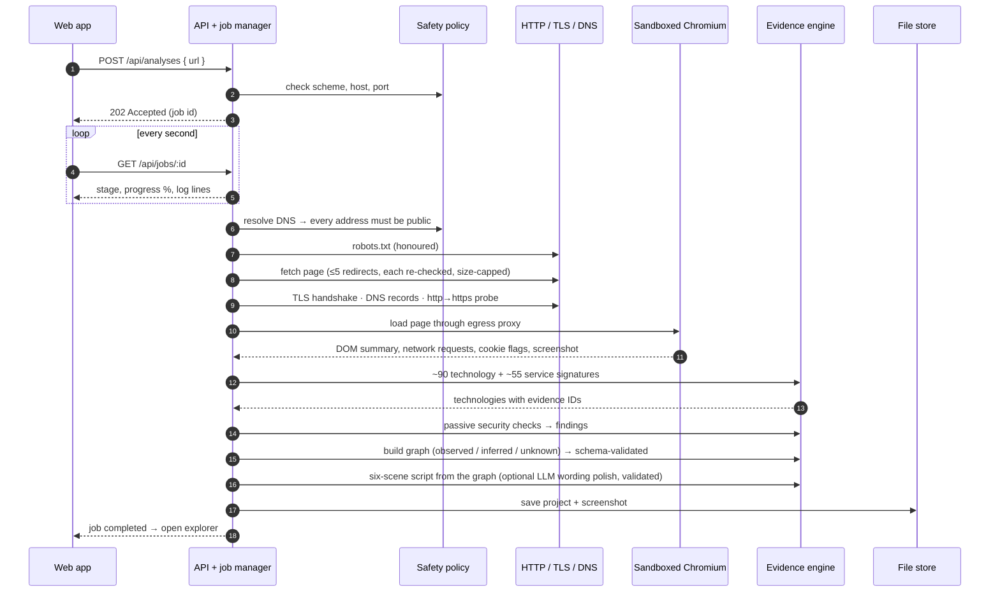

<sub>Diagram not showing? <a href="docs/diagrams/analysis-pipeline.png">View it as an image</a>.</sub>

How a component's status is decided:

| Status | Meaning | Example |
|---|---|---|
| **Observed** | Direct evidence was collected | `x-powered-by: Express` header → *Express (Node.js)* |
| **Inferred** | The evidence makes it likely, but it wasn't seen directly | First-party API calls answered → *an application backend exists* |
| **Unknown** | The public surface does not reveal it — shown explicitly instead of guessed | Database engine, internal services |

### 3. Video pipeline — from script to verified MP4

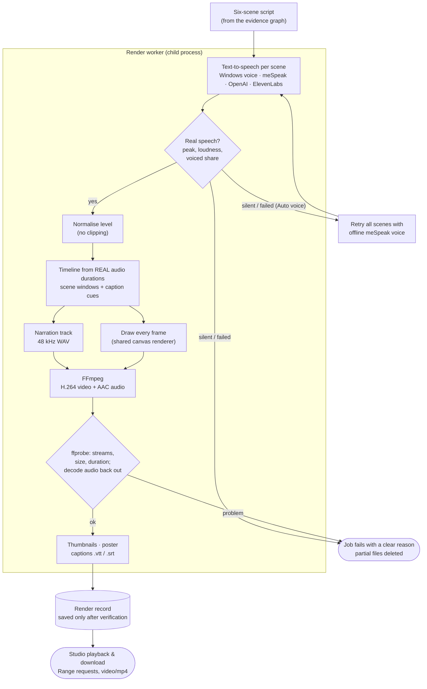

<sub>Diagram not showing? <a href="docs/diagrams/video-pipeline.png">View it as an image</a>.</sub>

### 4. Security boundary — how StackReel stays safe while loading untrusted sites

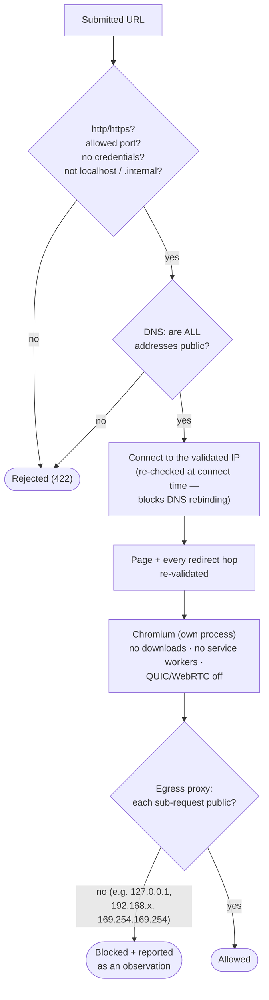

<sub>Diagram not showing? <a href="docs/diagrams/security-boundary.png">View it as an image</a>.</sub>

Blocked address ranges include loopback, private networks, link-local / cloud metadata (`169.254.169.254`), carrier-grade NAT, multicast, reserved and documentation ranges, IPv6 ULA/link-local, and private IPv4 hidden inside IPv6 forms (`::ffff:…`, NAT64 `64:ff9b::…`). Public sites reached through NAT64 networks (common on mobile ISPs) are allowed. Cookie values, query-string values and request bodies are never stored.

More detail: [`docs/ARCHITECTURE.md`](docs/ARCHITECTURE.md) · API reference: [`docs/API.md`](docs/API.md)

### Technology stack

| Layer | Technology |
|---|---|
| Web app | React 19, Vite 7, Tailwind CSS 4, React Flow (`@xyflow/react`), Motion, Lucide icons, self-hosted fonts |
| API server | Node.js 20+/22, Express 5, zod (validation), undici (HTTP client with pinned DNS) |
| Website inspection | Playwright + Chromium, Node TLS/DNS, custom egress proxy |
| Video | `@napi-rs/canvas` (frame drawing), FFmpeg/ffprobe (bundled via `@ffmpeg-installer`), H.264 + AAC |
| Voices | Windows SAPI / macOS `say` / Linux espeak-ng, meSpeak (offline), OpenAI TTS, ElevenLabs |
| Storage | JSON + media files on disk (`server/.data`), atomic writes |
| Tests | node:test + supertest, Vitest + Testing Library, Playwright end-to-end |

---

## Features

| Area | What it does |
|---|---|
| **Dashboard** | URL input with validation, live job progress with real stages and logs, cancel/retry, recent analyses with real screenshots, generated-video gallery, statistics only when backed by stored data. |
| **Architecture explorer** | Layer lanes (browser → edge → origin → frontend → API → backend → data, plus security and integrations bands), status-styled nodes, animated observed connections, search, status/layer filters, evidence panel, relationships, PNG and JSON export, auto-fit on any screen size. |
| **Security** | Passive findings (HTTPS, TLS version and certificate, HSTS, CSP, framing, cookies, mixed content, third-party scripts, version disclosure, requests to internal addresses), each with observation, evidence, severity, confidence, impact and fix. No misleading overall score. |
| **Evidence** | Raw response headers, redirect chain, TLS, DNS, cookie flags (never values), page fingerprints, and the full network-request table. |
| **Video studio** | MP4 playback (play/pause/seek/volume/fullscreen/captions), live audio meter, scene timeline with thumbnails and real waveform, subtitle preview, render settings (resolution, fps, voice, pace, burned-in captions), progress, MP4/SRT/VTT downloads, measured audio level, live preview before rendering. |
| **Themes** | Independently designed dark and light themes; follow your OS on first visit, remembered afterwards, no flash on load. |

---

## Narration voices

| `TTS_PROVIDER` | Notes |
|---|---|
| `auto` (default) | Your OS voice if available, else the built-in meSpeak voice. If the OS voice fails or is silent, the whole narration is redone with meSpeak and the Studio says so. Never picks a paid API automatically. |
| `system` | **Windows:** built-in voices (e.g. *Microsoft David / Zira*). macOS: `say`. Linux: `espeak-ng`. |
| `mespeak` | Built-in, offline, works everywhere (sounds robotic). |
| `openai` | Set `OPENAI_API_KEY` (optional `OPENAI_TTS_VOICE`). Paid. |
| `elevenlabs` | Set `ELEVENLABS_API_KEY` (optional `ELEVENLABS_VOICE_ID`). Paid. |

Every scene's speech is checked for real sound before use, and the finished MP4's audio is decoded and measured. The provider and voice can also be chosen per render in the Video Studio.

**Optional LLM narration polish:** `LLM_PROVIDER=anthropic` (+ `ANTHROPIC_API_KEY`) or `openai` (+ `OPENAI_API_KEY`). The LLM may only reword the evidence-based script; output that fails the schema or names technologies that weren't detected is rejected and the original script is used.

---

## Configuration

All settings live in `.env` at the project root — see [`.env.example`](.env.example) for every option.

| Variable | Default | Purpose |
|---|---|---|
| `PORT` | `5001` | API port. The dev web server reads the same `.env`, so both sides stay in sync. |
| `CLIENT_PORT` | `5173` | Web app dev port (fails clearly if already taken). |
| `CORS_ORIGINS` | – | Extra allowed browser origins, comma-separated. |
| `DATA_DIR` | `server/.data` | Where projects and videos are stored. |
| `BROWSER_EXECUTABLE_PATH` | – | Use your installed Chrome/Edge instead of the downloaded Chromium. |
| `TTS_PROVIDER` | `auto` | Narration voice provider (above). |
| `LLM_PROVIDER` | `none` | Optional narration polish. |
| `FFMPEG_PATH` / `FFPROBE_PATH` | bundled | Use your own FFmpeg. |

---

## Sharing a public link

StackReel has **no login yet**, so only share links for short demos.

Free option — run on your PC and expose it with Cloudflare Tunnel:

```powershell
winget install --id Cloudflare.cloudflared   # one time
npm run build
npm start                                     # window 1 → http://127.0.0.1:5001
cloudflared tunnel --url http://127.0.0.1:5001   # window 2 → prints https://….trycloudflare.com
```

If "Analyze" says *Origin … is not allowed*, add the printed link to `CORS_ORIGINS` in `.env` and restart `npm start`.

Always-on hosting needs a server with ~2 CPUs / 4 GB RAM, Node 22, Chromium (`npx playwright install --with-deps chromium`) and a persistent disk for `DATA_DIR`. Serverless hosts (Vercel, Netlify) are not suitable.

---

## Tests

```powershell
npm test              # backend (node:test) + frontend (Vitest)
npm run lint          # ESLint (web app) + syntax check (server/shared)
npm run build
npm run test:e2e      # drives the real UI in Chromium end to end (needs npm run build)
npm run screenshots   # regenerates docs/screenshots (needs npm run build)
```

| Suite | Covers |
|---|---|
| Backend — 55 tests | SSRF policy (IPv4/IPv6/NAT64, DNS rebinding, redirects), robots.txt, DNS retry, detection, graph/script schemas, LLM failure paths, jobs (dedupe/cancel/retry), CORS, validation, size limits, **real narrated MP4 renders** verified with ffprobe, decoded audio levels, voice fallback, media types and Range requests from `server/.data`, path-traversal refusal, failure cleanup |
| Frontend — 22 tests | URL validation, API errors, form submission, loading/empty/error states, theme persistence, graph model, studio playback state, media-error diagnosis, thumbnail placeholders |
| End-to-end — 25 checks | Analyze → explorer evidence → security → render → playback with decoded speech → seek/resume → MP4/SRT/VTT downloads → theme persistence → wide and mobile layouts → no console errors |

Tests never touch the internet: local fixture websites are reachable only through a test-only allow-list of exact `host:port` pairs.

---

## Troubleshooting

Run **`npm run doctor`** first — it checks FFmpeg, test-launches the browser, lists voices and checks ports, with a fix for each problem.

| Problem | Fix |
|---|---|
| **"Port 5001 is already in use"** | Another copy is running. Close it, or: `netstat -ano \| findstr :5001` then `taskkill /PID <PID> /F`. Or set `PORT=5002` in `.env`. |
| **"Backend unavailable"** | The API isn't running. Use `npm run dev` (starts both). The status chip in the top bar shows the live API state. |
| **"Origin … is not allowed"** | Open the app at `http://localhost:5173`, or add your address to `CORS_ORIGINS`. |
| **"Cannot find package 'express'"** | Run `npm install` from the **project root**. |
| **"Browser inspection failed … has been closed"** | StackReel retries in compatibility mode and falls back to installed Chrome/Edge. If it still fails: `npm run setup:browser`, or set `BROWSER_EXECUTABLE_PATH=C:\Program Files\Google\Chrome\Application\chrome.exe`. Analyses still complete with HTTP evidence. |
| **"resolves to a non-public address … nat64"** | Fixed — update to this version (public sites on NAT64/mobile networks are allowed). |
| **"could not be resolved (ENOTFOUND)"** | Check the spelling and your internet connection, then press **Retry** (StackReel already retries 3 times). |
| **Video won't play / thumbnails broken** | Fixed in this version (files in `server/.data` were refused). Update and restart — existing videos play without re-rendering. |
| **No narration sound** | The Studio's *Narration* panel shows the audio measured inside the MP4. If that's fine, check your PC volume and the player's volume slider. The live preview (before rendering) has no sound by design. |
| **Rendering is slow** | Choose 480p or 24 fps (default) and a shorter length; keep the laptop plugged in. The job log shows frames per second. |
| **PowerShell blocks npm** | `Set-ExecutionPolicy -Scope CurrentUser RemoteSigned` once, or use the `.cmd` files. |
| **Robotic voice** | That's meSpeak. Set `TTS_PROVIDER=system` for Windows voices, or configure OpenAI/ElevenLabs. |

---

## Known limitations

- **One page, one moment.** Only the submitted page is loaded, once. Logged-in areas, other pages and API calls made after user interaction are not seen.
- **Backends are usually invisible.** Unless headers or cookies reveal them, backend frameworks, databases and cloud topology are shown as inferred or unknown — by design.
- **Sites may block automation.** Bot protection, CAPTCHAs or `robots.txt` can stop an analysis; StackReel reports this instead of working around it.
- **Signatures, not magic.** Frameworks that leave no fingerprint aren't identified.
- **Security findings are passive.** A missing header is a hardening observation, not proof of a vulnerability. No active testing is ever done.
- **Single-user, local tool.** No accounts or login; keep `HOST=127.0.0.1` unless you add authentication. Jobs are in memory (lost on restart); projects and videos are kept on disk.
- **Bundled FFmpeg is an older static build (4.x)** — fine for this pipeline; set `FFMPEG_PATH` for a newer one.
- **Render time depends on your CPU** — roughly 1–6 minutes for a 3-minute 720p video.

---

## Project layout

```
stackreel/
├── client/                 Web app: React 19 + Vite + Tailwind 4 + React Flow + Motion
│   └── src/
│       ├── components/     dashboard · explorer · security · evidence · studio · jobs · layout · common
│       ├── context/        ThemeContext (no-flash theming), AppContext (API state, jobs, routing)
│       ├── lib/            API client, URL validation, router, formatting
│       └── test/           Vitest suites
├── server/                 API: Node.js + Express 5
│   ├── src/
│   │   ├── security/       IP policy (incl. NAT64), URL/DNS policy, browser egress proxy
│   │   ├── analysis/       HTTP/TLS/DNS inspector, browser inspector, robots, signatures,
│   │   │                   detector, security findings, graph builder, pipeline
│   │   ├── narration/      deterministic script, optional LLM polish, schemas
│   │   ├── tts/            voice providers (system / meSpeak / OpenAI / ElevenLabs)
│   │   ├── render/         render supervisor, render worker, media + audio checks
│   │   ├── jobs/           job manager
│   │   ├── store/          file store
│   │   └── routes/ middleware/ config.js logger.js app.js index.js
│   ├── scripts/            doctor, syntax check
│   └── test/               node:test suites + local fixture websites
├── shared/                 graph layout, scene renderer, timeline (server AND browser)
├── scripts/                e2e.mjs (end-to-end test), screenshots.mjs (README images)
├── docs/                   ARCHITECTURE.md, API.md, screenshots/
├── setup-windows.cmd       one-time setup (double-click)
├── start-windows.cmd       start StackReel (double-click)
└── PROJECT_AUDIT.md        defects found, fixes and test results
```

## Ethics

StackReel makes the same requests a visitor's browser would, once, and honours `robots.txt`. It never bypasses logins, paywalls, CAPTCHAs or access controls, never stores cookie values or request bodies, and never runs intrusive scans.

Made by Anwita Padhi
